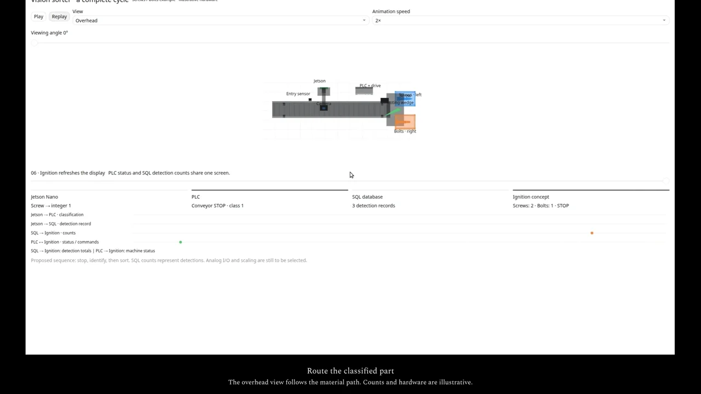

# Vision sorter concept

An animated control-sequence concept for sorting screws and bolts. A camera and Jetson classify each part; a PLC coordinates the conveyor and diverter. The page also illustrates detection records and a possible reporting view.

[](https://trylen22.github.io/demos/sorter/)

[Watch the captioned demonstration](https://trylen22.github.io/demos/sorter/). The page also provides the MP4 and subtitle file.

[Open the interactive animation](https://trylen22.github.io/capstone-vision-sorter/).

## Run locally

```bash
git clone https://github.com/Trylen22/capstone-vision-sorter.git
cd capstone-vision-sorter
python3 -m http.server 8000 --bind 127.0.0.1
```

Open `http://127.0.0.1:8000/`. Use Pause, Replay, the view selector, and the animation-speed control to inspect the cycle. The page is self-contained and does not require a package installation.

## Proposed sequence

1. Detect an incoming object and stop it at the inspection position.
2. Capture an image and assign a part class.
3. Transfer the result to the PLC.
4. Position the diverter and move the part into its destination.
5. Record the detection and update the reporting view.

## Scope

This repository contains a concept animation. It does not connect to a camera, PLC, SQL database, or Ignition server. Displayed counts are illustrative detection records. Hardware selection, I/O scaling, communication, physical interlocks, and commissioning remain separate implementation work.
